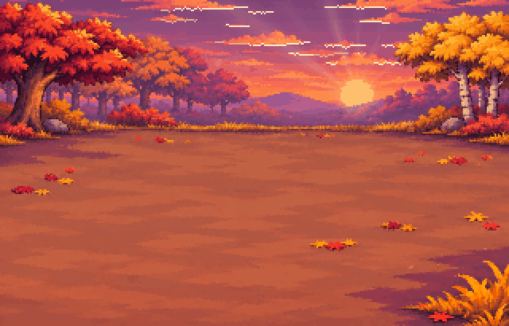
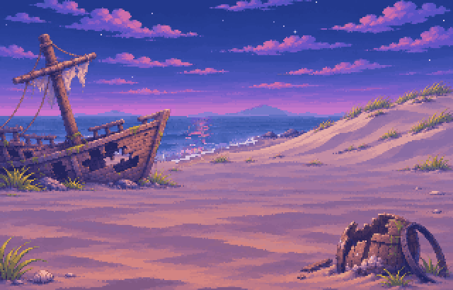
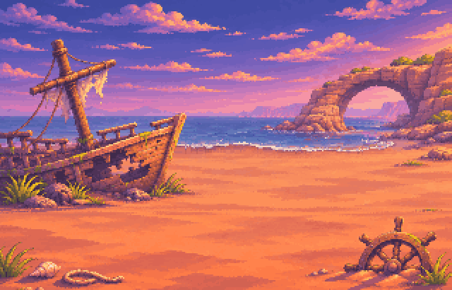
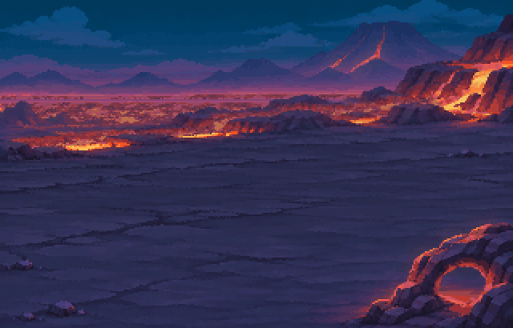
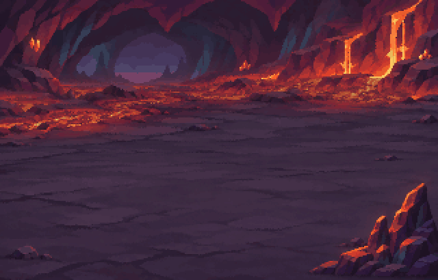
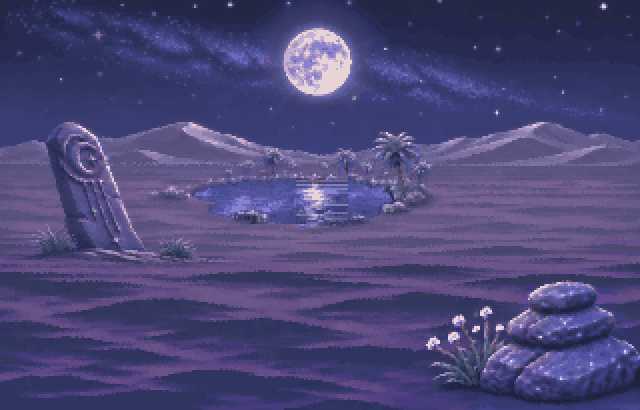
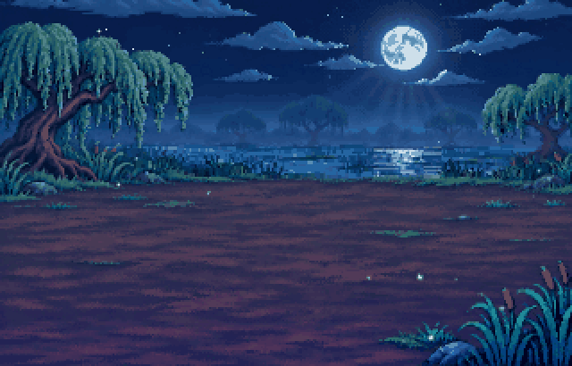
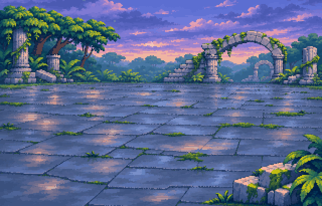
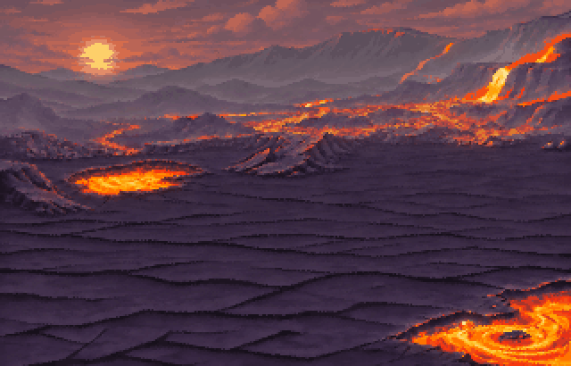
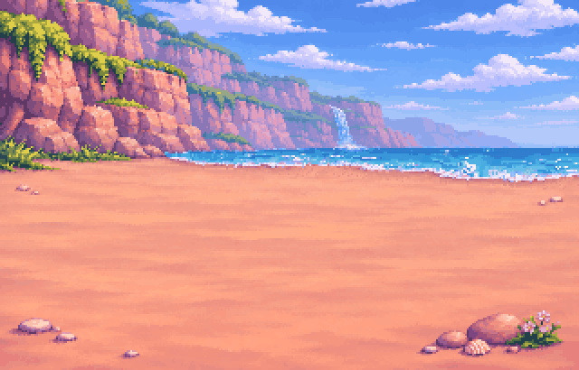

# Showdown Plus

A visual mod for [Pokémon Showdown](https://play.pokemonshowdown.com) battles: animated pixel-art battle backgrounds,
hand-made move animations (VFX), and a battle style and userscript that go with them. Every battle gets one of the
installed maps at random.

## What you need

- [Stylus](https://add0n.com/stylus.html) (browser extension) for the styles
- A userscript manager such as Tampermonkey or Violentmonkey for the userscript

## Install

Click each link below: your userscript manager or Stylus opens its install page. Installed this way, everything
updates itself (see [Updates](#updates)).

1. **Userscript:** [install](https://raw.githubusercontent.com/dasmins/showdown-plus/main/userscript/showdown-pin-controls.user.js)
2. **Main style:** [install](https://raw.githubusercontent.com/dasmins/showdown-plus/main/styles/showdown-battle-style.user.css)
3. **Maps:** install the ones you want from the table under [The maps](#the-maps). Each map is its own style, so you
   can turn single maps on and off in Stylus; each battle picks one of the ones that are on. A map that is off
   doesn't load at all.
4. **VFX (optional):** [Surf](https://raw.githubusercontent.com/dasmins/showdown-plus/main/vfx/surf/showdown-vfx-surf.user.css),
   [Hydro Pump](https://raw.githubusercontent.com/dasmins/showdown-plus/main/vfx/hydro-pump/showdown-vfx-hydro-pump.user.css),
   [Ice Beam](https://raw.githubusercontent.com/dasmins/showdown-plus/main/vfx/ice-beam/showdown-vfx-ice-beam.user.css)
5. **Your settings:** open [`styles/showdown-plus-my-settings.user.css`](styles/showdown-plus-my-settings.user.css),
   copy all of it, and in Stylus choose *Manage* > *Write new style*, paste, and save. Don't install this one from a
   link: pasted in, it never updates, so your numbers are never overwritten.

If you had older versions installed (names starting "Showdown - ..." or "Showdown VFX - ...", and the userscript
"Showdown - pin controls to battle window"), remove them first. Two map styles in the same slot draw over each other,
and two copies of the userscript would both run.

## Updates

Stylus and Tampermonkey check for new versions on their own and install them (Stylus: *Manage* > *Check for updates*
does it now; Tampermonkey: *Utilities* > *Check for userscript updates*). Only the files that changed are downloaded.

An update replaces the whole style, so **don't edit the main style or the maps**: put your changes in your
*Showdown Plus - my settings* style instead. Anything there wins over the main style and the maps:

- a general setting: copy its line from the main style's SETTINGS block into the `html:root:root { }` block
- one map's own numbers: use the `html:root:root body .battle[data-ps-map="N"][data-ps-map] { }` block (N = its slot)
- hide a map without uninstalling it: `--map-N-on: 0;`

The main style shows a small red note in the battle if the userscript is missing or is the wrong version.

## VFX mod: Surf, Hydro Pump and Ice Beam

[`vfx/`](vfx) has hand-made move animations, each its own Stylus style: Surf, Hydro Pump and Ice Beam. Ice Beam needs the
userscript 2.44.0 or later. See [`vfx/README.md`](vfx/README.md) to install them, change them, and restore earlier versions.

## Tuning

All settings are at the top of the main style, in its SETTINGS block:

- `--map-pick: 0` picks a map at random each battle; `1` to `20` always shows that slot (handy while tuning one map).
- `--bg-zoom`, `--bg-x`, `--bg-y` place every background. To give one map its own, uncomment those lines in that
  map's "THIS MAP'S OWN NUMBERS" block. The maps are pixel art: zoom 1, 1.5 and 2 keep the pixels even.
- `--map2-shadow-angle-foe` and so on give a map its own shadow angles (see section 5 of the settings).

## The maps

Each map is a 320x205 pixel-art loop, 200 frames at 10 frames a second (20 seconds), shown at 640x410 with sharp
pixels. Maps 2-20 are stored in their styles as lossless animated WebP (the same pixels as the GIFs, about 28%
smaller); the tower stays a GIF, since the userscript times its serpent from it. The GIFs on their own are in
[`gifs-320x205/`](gifs-320x205).

A map that is turned off in Stylus doesn't load at all, so keeping only the maps you want also keeps Showdown light.
Style sizes: the lava maps are the heaviest (0.9-1.2 MB each, the whole floor moves), the ruins the lightest (0.2-0.4 MB).

The scripts that made the maps are in [`tools/`](tools) (see [`tools/README.md`](tools/README.md)).

| Slot | Map (click to install) | Preview |
|---|---|---|
| 1 | [tower3 serpent](https://raw.githubusercontent.com/dasmins/showdown-plus/main/styles/maps/map01-tower3-serpent.user.css) |  |
| 2 | [autumn forest clearing](https://raw.githubusercontent.com/dasmins/showdown-plus/main/styles/maps/map02-autumn-forest-clearing.user.css) |  |
| 3 | [autumn ruined courtyard](https://raw.githubusercontent.com/dasmins/showdown-plus/main/styles/maps/map03-autumn-ruined-courtyard.user.css) |  |
| 4 | [blue hour shipwreck dunes](https://raw.githubusercontent.com/dasmins/showdown-plus/main/styles/maps/map04-blue-hour-shipwreck-dunes.user.css) |  |
| 5 | [dawn shipwreck headland](https://raw.githubusercontent.com/dasmins/showdown-plus/main/styles/maps/map05-dawn-shipwreck-headland.user.css) |  |
| 6 | [erupting volcanoes basalt outcrop 10](https://raw.githubusercontent.com/dasmins/showdown-plus/main/styles/maps/map06-erupting-volcanoes-basalt-outcrop-10.user.css) |  |
| 7 | [golden hour shipwreck](https://raw.githubusercontent.com/dasmins/showdown-plus/main/styles/maps/map07-golden-hour-shipwreck.user.css) |  |
| 8 | [lava battle floor stone arch 04](https://raw.githubusercontent.com/dasmins/showdown-plus/main/styles/maps/map08-lava-battle-floor-stone-arch-04.user.css) |  |
| 9 | [lava cavern basalt outcrop 08](https://raw.githubusercontent.com/dasmins/showdown-plus/main/styles/maps/map09-lava-cavern-basalt-outcrop-08.user.css) |  |
| 10 | [misty shipwreck](https://raw.githubusercontent.com/dasmins/showdown-plus/main/styles/maps/map10-misty-shipwreck.user.css) |  |
| 11 | [moonlit desert oasis](https://raw.githubusercontent.com/dasmins/showdown-plus/main/styles/maps/map11-moonlit-desert-oasis.user.css) |  |
| 12 | [moonlit lava mountains outcrop 07](https://raw.githubusercontent.com/dasmins/showdown-plus/main/styles/maps/map12-moonlit-lava-mountains-outcrop-07.user.css) |  |
| 13 | [moonlit shipwreck shore](https://raw.githubusercontent.com/dasmins/showdown-plus/main/styles/maps/map13-moonlit-shipwreck-shore.user.css) |  |
| 14 | [moonlit willow marsh](https://raw.githubusercontent.com/dasmins/showdown-plus/main/styles/maps/map14-moonlit-willow-marsh.user.css) |  |
| 15 | [rain washed ruins](https://raw.githubusercontent.com/dasmins/showdown-plus/main/styles/maps/map15-rain-washed-ruins.user.css) |  |
| 16 | [rose cliff shipwreck shore](https://raw.githubusercontent.com/dasmins/showdown-plus/main/styles/maps/map16-rose-cliff-shipwreck-shore.user.css) |  |
| 17 | [snowy ruins lavender dawn](https://raw.githubusercontent.com/dasmins/showdown-plus/main/styles/maps/map17-snowy-ruins-lavender-dawn.user.css) |  |
| 18 | [stormlit basalt beach](https://raw.githubusercontent.com/dasmins/showdown-plus/main/styles/maps/map18-stormlit-basalt-beach.user.css) |  |
| 19 | [volcanic arena orange sun](https://raw.githubusercontent.com/dasmins/showdown-plus/main/styles/maps/map19-volcanic-arena-orange-sun.user.css) |  |
| 20 | [waterfall beach](https://raw.githubusercontent.com/dasmins/showdown-plus/main/styles/maps/map20-waterfall-beach.user.css) |  |
