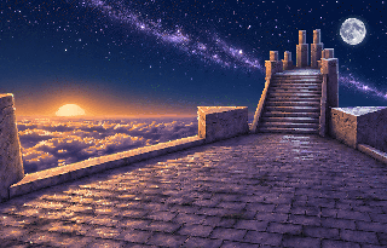
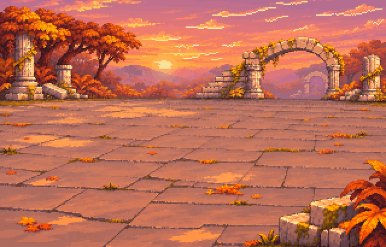
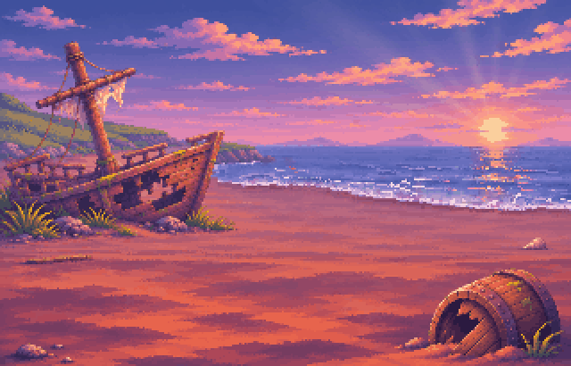
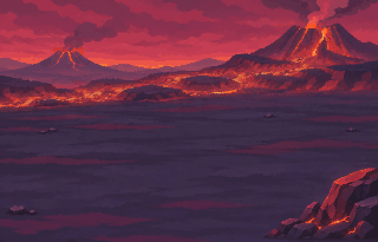
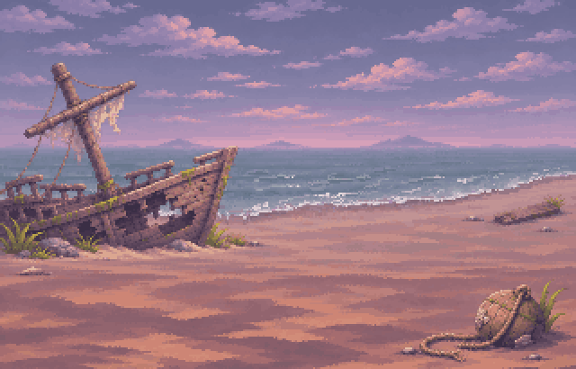
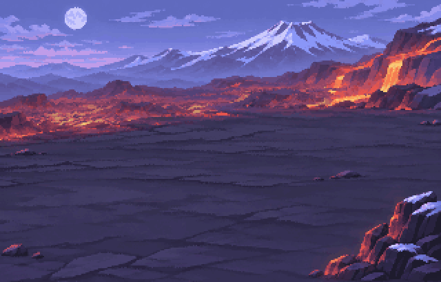
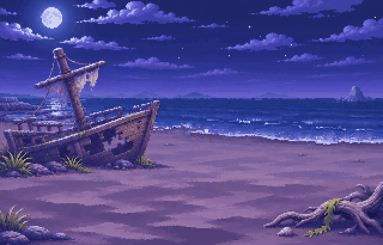
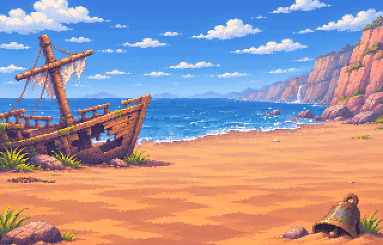
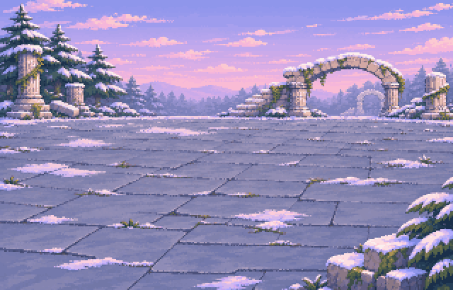
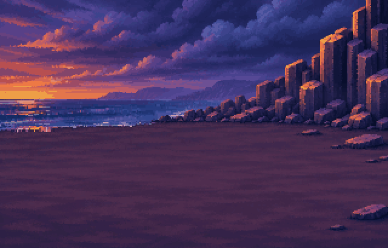

# Showdown animated battle backgrounds

Animated backgrounds for [Pokémon Showdown](https://play.pokemonshowdown.com) battles, with a battle style and a
userscript that go with them. Every battle gets one of the installed maps at random.

## What you need

- [Stylus](https://add0n.com/stylus.html) (browser extension) for the styles
- A userscript manager such as Tampermonkey or Violentmonkey for the userscript

## Install

1. **Userscript:** open [`userscript/showdown-pin-controls.user.js`](userscript/showdown-pin-controls.user.js), click
   *Raw*, and your userscript manager offers to install it.
2. **Main style:** open [`styles/showdown-battle-style.user.css`](styles/showdown-battle-style.user.css), click *Raw*,
   and Stylus opens its install page.
3. **Maps:** do the same for each map you want in [`styles/maps/`](styles/maps). Each map is its own style, so you can
   turn single maps on and off in Stylus. Install as many as you like (up to 20); each battle picks one of the ones
   that are on.

If you had older map styles installed, turn them off first: maps share slot numbers, and two styles in the same slot
draw over each other.

The main style shows a small red note in the battle if the userscript is missing or is the wrong version.

## VFX mod: Surf and Hydro Pump

[`vfx/`](vfx) has hand-made move animations, each its own Stylus style: Surf and Hydro Pump. They need the userscript
2.41.0 or later. See [`vfx/README.md`](vfx/README.md) to install them, change them, and restore earlier versions.

## Tuning

All settings are at the top of the main style, in its SETTINGS block:

- `--map-pick: 0` picks a map at random each battle; `1` to `20` always shows that slot (handy while tuning one map).
- `--bg-zoom`, `--bg-x`, `--bg-y` place every background. To give one map its own, uncomment those lines in that
  map's "THIS MAP'S OWN NUMBERS" block. The maps are pixel art: zoom 1, 1.5 and 2 keep the pixels even.
- `--map2-shadow-angle-foe` and so on give a map its own shadow angles (see section 5 of the settings).

## The maps

Each map is a 320x205 pixel-art loop, 200 frames at 10 frames a second (20 seconds), shown at 640x410 with sharp
pixels. Maps 2-20 are stored in their styles as lossless animated WebP (the same pixels as the GIFs, about 28%
smaller); the tower stays a GIF, since the userscript times its serpent from it. The GIFs on their own are in
[`gifs-320x205/`](gifs-320x205).

A map that is turned off in Stylus doesn't load at all, so keeping only the maps you want also keeps Showdown light.
Style sizes: the lava maps are the heaviest (0.9-1.2 MB each, the whole floor moves), the ruins the lightest (0.2-0.4 MB).

The scripts that made the maps are in [`tools/`](tools) (see [`tools/README.md`](tools/README.md)).

| Slot | Map | Preview |
|---|---|---|
| 1 | tower3 serpent |  |
| 2 | autumn forest clearing |  |
| 3 | autumn ruined courtyard |  |
| 4 | blue hour shipwreck dunes |  |
| 5 | dawn shipwreck headland |  |
| 6 | erupting volcanoes basalt outcrop 10 |  |
| 7 | golden hour shipwreck |  |
| 8 | lava battle floor stone arch 04 |  |
| 9 | lava cavern basalt outcrop 08 |  |
| 10 | misty shipwreck |  |
| 11 | moonlit desert oasis |  |
| 12 | moonlit lava mountains outcrop 07 |  |
| 13 | moonlit shipwreck shore |  |
| 14 | moonlit willow marsh |  |
| 15 | rain washed ruins |  |
| 16 | rose cliff shipwreck shore |  |
| 17 | snowy ruins lavender dawn |  |
| 18 | stormlit basalt beach |  |
| 19 | volcanic arena orange sun |  |
| 20 | waterfall beach |  |
